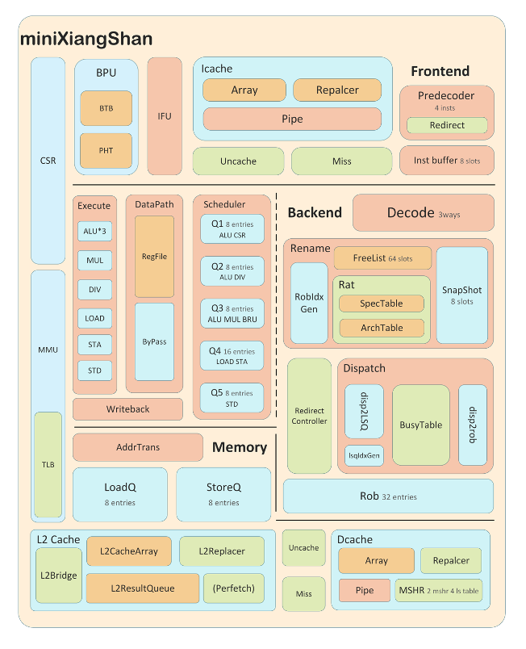

# miniXiangShan

这是 miniXiangShan 乱序核的独立仓库。默认 `simu`/`fpga` 配置保持 RV32；
性能实验把 miniXiangShan 配置为 RV64，使其与 NutShell 运行同一份机器码。
miniXiangShan 本体在 `src/`，性能实验在 `perf/`；两者共用仓库根目录的
`build.sbt` 和 `Makefile`。

仓库不保存 NutShell 或 CoreMark 的源码副本。首次运行性能实验时，脚本从
`perf/deps.lock` 记录的官方仓库检出指定版本，放到被忽略的 `.deps/` 目录，再
应用主仓库中的小型适配补丁。



## 目录

| 路径 | 作用 |
| --- | --- |
| `src/main/scala/` | miniXiangShan 核的实现 |
| `perf/run.sh` | 性能对比的唯一总入口 |
| `perf/platform/` | 共享 AXI4 平台、Verilator testbench、CoreMark/NutShell 适配层 |
| `perf/patches/` | 对外部源码仓库应用的最小补丁及原因说明 |
| `perf/scripts/` | 依赖准备、镜像构建、RTL 构建、运行和校验 |
| `perf/deps.lock` | NutShell/CoreMark 的仓库地址与版本 |
| `perf/results/` | 最近一次运行的日志和比较结果（生成物） |
| `perf/README.md` | 命令的输入、输出和执行过程 |
| `perf/METHODOLOGY.md` | 计数口径、正确性门禁和公平性边界 |
| `INTEGRATION.md` | 在 XiangShanLab 中作为 submodule 接入的方法 |

## 环境要求

- JDK、sbt：生成 miniXiangShan RTL。
- mill：生成 NutShell RTL。
- Verilator：两个 RTL 仿真器。
- `riscv64-unknown-elf-gcc` 和 binutils：RV32/RV64 CoreMark 镜像。
- C 编译器 `cc`：CoreMark host 参考程序。
- Git 和网络：首次获取外部源码；之后使用 `.deps/` 缓存。

## 唯一性能命令

```bash
cd /path/to/miniXiangShan
make perf
```

该命令依次完成：

1. 从官方 Git 仓库检出固定版本的 NutShell 与 CoreMark。
2. 应用 `perf/patches/` 中的 NutShell/CoreMark 补丁。
3. 构建 CoreMark host 参考以及 RV32/RV64 裸机镜像。
4. 生成并构建 miniXiangShan 与 NutShell 的 Verilator 模型。
5. 在同一个 AXI4 DRAM/MMIO/console 平台上运行 CoreMark。
6. 校验 host 和两个 RTL 运行的 CoreMark CRC，再比较 cycles、instret 和 IPC。

终端会显示 CoreMark 的完整打印信息以及最终比较表；结果同时写入
`perf/results/`。命令成功返回 0，任一构建、仿真或校验失败都会非零退出。
可调输入、输出文件和逐阶段细节见 `perf/README.md`。

恢复到类似初次克隆的工作区：

```bash
make clean
```

该命令删除 `.deps/`、RTL、Verilator 模型、Scala 缓存、结果日志和编辑器构建缓存；
下次执行 `make perf` 时会重新从 `perf/deps.lock` 获取外部源码。

## 最近验证结果

以下是当前正式 Scala 生成 RTL 的验证结果。NutShell 使用 `CORE=ooo`，
两边都通过 CoreMark 2K performance 配置、`ITERATIONS=10`：

| CPU | ISA | cycles | instret | IPC | crcfinal |
| --- | --- | ---: | ---: | ---: | ---: |
| NutShell OOO | RV64 | 3,406,098 | 3,589,212 | 1.053761 | `0xfcaf` |
| miniXiangShan | RV64 | 3,255,350 | 3,589,207 | 1.102556 | `0xfcaf` |

两边运行同一份 `coremark-rv64.hex`，均通过 `signature=0x434d524b`、全部
sub-CRC 和 `errors=0` 校验。

```text
cycles_ratio=0.955742 instret_ratio=0.999999 ipc_ratio=1.046306
```

mini 比 NutShell 少用 4.43% 周期（同频率比较，未测量综合频率）。
`make test-pipeline` 运行 RV32/RV64 访存、唤醒和取指功能回归。

## 外部源码策略

- NutShell 固定到 `OSCPU/NutShell` 的提交
  `a854aead78cf3c5e54a76f8724fe182d4de914d3`，并初始化其 `difftest`
  子模块。
- CoreMark 固定到 `eembc/coremark` 的 `v1.01` 标签，对应提交
  `cfa9ab377835911f23d9b0831c7be302ed1f58de`；框架与算法源文件再用
  SHA-256 校验，运行后记录实际提交。
- 主仓库只保留 NutShell 性能适配 top、CoreMark 裸机 port 和上游补丁，不保留
  第三方核与 benchmark 算法源码。NutShell 补丁包括 Chisel 7/性能顶层适配，
  以及一个 OOO 双退休写同一架构寄存器时的优先级修复。
- 修改、修改原因和补丁边界见 `perf/patches/README.md`。

最近一次运行的原始计数、校验值和派生比值以 `make perf` 生成的文件为准。

## 在 XiangShanLab 中接入

主仓库完成后，XiangShanLab 只应引用本仓库，不应再维护可编辑副本。推荐使用
Git submodule；没有远端时的本地符号链接方案见 `INTEGRATION.md`。
