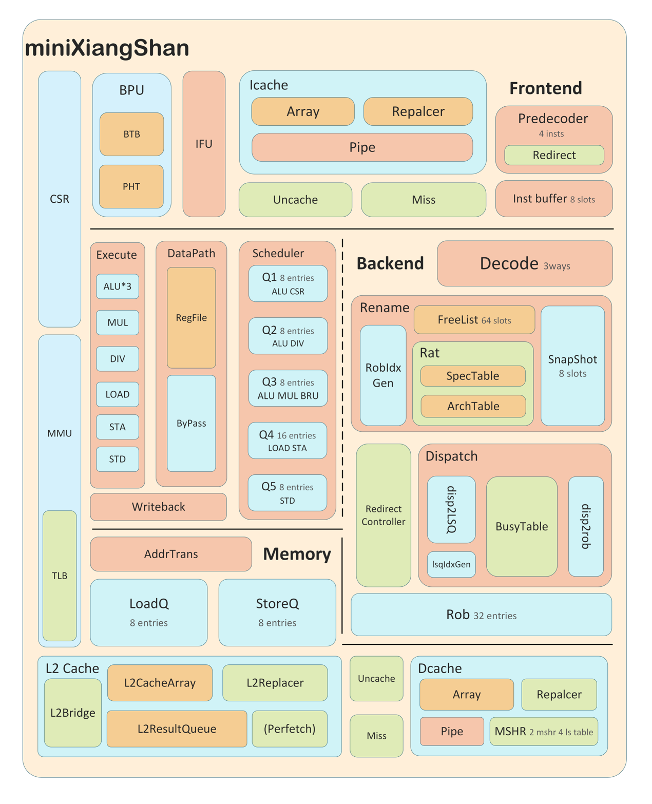

# miniXiangShan

miniXiangShan 是 RV64 乱序核，支持 RV64IM、Zicsr/Zifencei、M/S/U 特权模式和
Bare/Sv39 地址翻译。工程分为 CPU 仿真器、应用和 NutShell 性能对比三个部分。

工作流参考[香山的构建和运行方式](https://docs.xiangshan.cc/zh-cn/dev/tools/xsenv-en/)：
在根目录构建 `emu`，在应用自己的目录编译镜像，再手动执行仿真器。
这里提供本项目的轻量裸机运行环境，应用链接到 `0x80000000`。



## 构建 CPU 仿真器

在仓库根目录执行：

```bash
make emu
```

构建生成 `build/emu`，默认启用 NEMU 差分和 FST 波形支持。
命令完成后会打印应用编译和仿真命令示例；应用由用户另外编译、运行。
直接执行 `make` 等价于 `make emu`，`make help` 查看参数。

```bash
make emu JOBS=8
make emu WITH_DIFFTEST=0 WITH_WAVE=0
```

| 参数 | 默认值 | 作用 |
| --- | --- | --- |
| `WITH_DIFFTEST` | `1` | 编译差分功能，自动从固定版本构建 NEMU |
| `WITH_WAVE` | `1` | 编译 FST 波形支持，运行时用 `--wave` 记录 |
| `JOBS` | `8` | C/C++ 构建并行度 |
| `SBT`、`VERILATOR` | 自动查找 | 工具可执行文件 |
| `BUILD_DIR`、`DEPS_DIR` | `build/`、`.deps/` | 构建目录、第三方源码缓存 |

BPU、Load Queue 和 L2 预取策略统一在 `src/main/scala/config/Core.scala` 的
`CoreConfigKeys` 中配置，修改后重新构建即可。

RTL 缓存依据源码内容、配置、`build.sbt` 和固定的 sbt 版本计算，新增和删除
源码也会触发重建。不同 emu 配置使用独立对象目录，最终选中的版本安装为
`build/emu`；参考库安装到 `build/ref/`，运行时按仿真器位置查找。

## 编译应用并手动运行

每个应用都在 `apps/<name>/` 中执行自己的 `make`：

```bash
cd apps/hello
make
cd ../..
./build/emu -i apps/hello/build/hello.bin
```

CoreMark 同样独立编译：

```bash
cd apps/coremark
make ITERATIONS=10
cd ../..
./build/emu -i apps/coremark/build/coremark.bin
```

应用输出为各自 `build/` 下的 ELF、BIN、HEX、反汇编文件。`emu -i` 接收 BIN，
对比平台使用同一次编译生成的 HEX。ELF 和 HEX 不能直接传给 `emu -i`。

```bash
./build/emu -i apps/hello/build/hello.bin --no-diff
./build/emu -i apps/hello/build/hello.bin --wave build/hello.fst --trace build/hello.log
./build/emu --help
```

带差分构建默认开启对比；`--no-diff` 可在本次运行关闭。普通裸机程序可以
用 `ebreak` 退出，`a0=0` 表示成功。示例应用还支持性能 MMIO 完成协议。
默认允许尚未提交的推测读取越过内存映射，静默返回占位数据；实际提交的
非法 load/store 仍会报错。正常完成输出 `EMU_RESULT status=success`，`reason`
记录结束原因。用 `--strict-axi-reads` 可恢复 AXI 越界读立即停止。
差分检查范围见 [difftest/README.md](difftest/README.md)，新增应用方法见
[apps/README.md](apps/README.md)。

## 与 NutShell 对比

在独立的 `compare/` 目录中选择已经编译的应用：

```bash
cd compare
make build
make run APP=coremark
make run APP=coremark NUTSHELL_CORE=inorder
make run APP=hello RETIRE_TRACE=0
```

`make build` 构建两边的性能仿真器；`make run` 会先检查所选应用的产物，
再增量构建和运行两边，校验结果并比较 cycles、instret、IPC。
两边使用同一个外部 AXI4 平台、同一份应用镜像。结果写入
`compare/results/<app>/<core>/`。`NUTSHELL_CORE=ooo/inorder` 选择乱序或顺序
果壳，默认 `ooo`；两种配置的构建缓存和结果分别保存。
具体契约见 [compare/README.md](compare/README.md)。

该性能对比以应用自检、校验和及可选的退休轨迹为依据。
逐指令 NEMU 差分由根目录的 `build/emu` 提供。

## 目录与清理范围

```text
Makefile                   CPU 仿真器构建入口
scripts/                   公共构建、RTL 生成、依赖和清理工具
src/main/scala/            CPU 与仿真顶层实现
src/test/scala/            Chisel 模块测试
difftest/csrc/             emu 驱动与 NEMU 对接
difftest/deps.lock         NEMU 固定版本
apps/common/               应用共用启动代码、链接脚本和编译规则
apps/hello/                 最小示例应用，独立 Makefile
apps/coremark/              CoreMark port、固定依赖、独立 Makefile
compare/                   NutShell 对比入口、平台、补丁、分析工具
build/                     CPU RTL、仿真器、参考库
.deps/                     外部源码缓存
project/build.properties   构建时自动生成的 sbt 版本文件
```

| 命令 | 清理范围 |
| --- | --- |
| 根目录 `make clean-all` | 全部构建产物：CPU、应用、对比仿真器、Scala 缓存、仓库内 `.deps/`，以及 `out/`、`out-perf/`、`obj_dir/`、`test_run_dir/`；保留 `compare/results/` |
| 根目录 `make clean` | CPU 构建产物、Scala 编译缓存、生成的 sbt 版本文件和仓库内 `.deps/` |
| 根目录 `make clean-apps` | 所有应用自己的构建产物（`apps/*/build/`） |
| 根目录 `make clean-compare` | 性能对比仿真器和 RTL（`compare/build/`） |
| `make -C apps/hello clean` | hello 自己的构建产物 |
| `make -C compare clean` | 性能对比仿真器和 RTL |
| `make -C compare clean-results APP=hello` | hello 的对比结果 |

清理保留编辑器配置。`project/build.properties` 被 Git 忽略，清理后下次构建
会自动生成，默认使用 sbt `2.0.2`；已有文件中的版本设置会被采用。
自定义到仓库标准目录之外的构建或缓存目录由使用者手动清理，避免删除无关目录。

## 环境与进阶操作

- CPU 仿真器：JDK、sbt、Verilator、C++17 编译器、make、Python 3、Git、flock。
- NEMU：flex、bison、readline/zlib/zstd 开发库及其固定版本要求的依赖。
- 应用：`riscv64-unknown-elf-gcc` 和 binutils，或通过 `CROSS_COMPILE` 指定兼容工具链。
- CoreMark host 参考程序：本机 C 编译器 `HOST_CC`。
- NutShell 对比：额外需要 mill。

模块测试仍可直接用 sbt 执行，例如 `sbt test`；构建 emu 不会自动运行模块测试。
FPGA 和旧 DPI 平台按需直接生成：

```bash
RTL_DIR=build/rtl sbt 'runMain minixiangshan.CoreGen fpga'
RTL_DIR=build/rtl sbt 'runMain minixiangshan.CoreGen simu'
```

旧 DPI 平台需要外部测试平台实现黑盒。FPGA 外部互联、存储和 RAM IP 须匹配
生成的 64 位接口。本项目尚未实现 PMP/PMA；Sv39 支持 4 KiB、2 MiB、1 GiB 页，
A/D 位由软件维护。性能对比的外部平台使用 32 位物理地址窗口。

外部源码与补丁来源见 [PROVENANCE.md](PROVENANCE.md)，父工程接入见
[INTEGRATION.md](INTEGRATION.md)。
